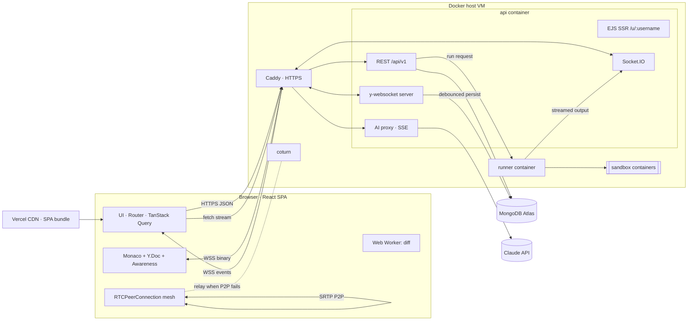

# 🌐 DevVerse — Multiplayer Coding World
### Project Execution Plan · Web Development Course · v2 (3 people · 4 weeks · MongoDB)

> *Think GitHub + Discord + VS Code + multiplayer game.*
> Developers enter virtual rooms where they can code together, see each other's cursors, talk over voice/video, run code in isolated containers, create projects, review code, ask an AI assistant, compete in coding challenges, and build public portfolios.
>
> **Core technical challenge:** a real-time collaborative code editor built on WebSockets and WebRTC.

---

## Table of Contents
1. [Constraints & Strategy](#1-constraints--strategy)
2. [Scope: What Ships in 4 Weeks](#2-scope-what-ships-in-4-weeks)
3. [Tech Stack (MERN + TypeScript)](#3-tech-stack-mern--typescript)
4. [Hosting & the Docker Host](#4-hosting--the-docker-host)
5. [System Architecture](#5-system-architecture)
6. [MongoDB Data Model](#6-mongodb-data-model)
7. [API & Real-Time Contract](#7-api--real-time-contract)
8. [Team Roles](#8-team-roles)
9. [Week-by-Week Execution Plan](#9-week-by-week-execution-plan)
10. [Web Development Concepts Coverage Matrix](#10-web-development-concepts-coverage-matrix)
11. [Security Plan](#11-security-plan)
12. [Testing Strategy](#12-testing-strategy)
13. [Performance & Accessibility Targets](#13-performance--accessibility-targets)
14. [Documentation Plan](#14-documentation-plan)
15. [Risks & Mitigations](#15-risks--mitigations)
16. [Final Demo Script](#16-final-demo-script)
17. [Day 0 Checklist (before coding starts)](#17-day-0-checklist-before-coding-starts)

---

## 1. Constraints & Strategy

| Constraint | Value |
|---|---|
| Team | 3 developers |
| Timeline | 4 weeks (28 days), assuming about 20–25 hours per person per week |
| Database | MongoDB (Atlas) |
| Budget | Free tiers plus GitHub Student Developer Pack credits |

**Rules for a 4-week build**
1. **Deploy a working skeleton by Day 4.** Deploying a thin end-to-end slice first means hosting, HTTPS, cookies, WebSockets and CORS problems show up in Week 1, not the night before the demo.
2. **Three parallel tracks** (Frontend, Real-time, Platform), with an integration checkpoint every Friday.
3. **Use proven libraries for the hard parts** (Yjs for edit merging, Monaco for the editor, Socket.IO for events). The learning value lives in the integration, the security and the documentation.
4. **Feature freeze on Day 23.** Days 24–28 go to testing, security, accessibility, documentation and the demo only.
5. **Few moving parts:** no Redis and no message broker. A single API instance with in-process queues is enough for the demo. The plan to scale beyond that is documented in an ADR rather than built.

---

## 2. Scope: What Ships in 4 Weeks

All nine features from the brief ship at least at a basic level. Tiers set the order of work and what gets cut if time runs short.

| Feature (from the brief) | 🟢 Tier 1 — must (Weeks 1–2) | 🟡 Tier 2 — should (Week 3) | ⚪ Tier 3 — if time (Week 4, Days 22–23) |
|---|---|---|---|
| **Virtual rooms** | Create/join by invite link, roles (owner/editor/viewer), presence list, text chat | Typing indicator, chat history pagination | 2D Canvas **world lobby** with walking avatars |
| **Code together** | Monaco + Yjs real-time sync, multi-file project tree | Offline edits merge on reconnect (shown in the demo) | Follow-user mode |
| **See each other's cursors** | Coloured cursors and selections with name labels (Yjs Awareness) | — | — |
| **Voice/video** | — | WebRTC audio + video mesh (≤ 4), mute/camera toggles | Screen share, speaking indicator |
| **Run code in containers** | JS + Python in a Docker sandbox, output broadcast to the room | C++ + Java, stdin input | Run history |
| **Create projects** | Project + file CRUD, autosave | Snapshots (versions), ZIP export | Fork a public project |
| **Review code** | — | Snapshot diff view + inline line comments + resolve | Review approval states |
| **AI assistant** | — | Streamed chat panel; Explain / Fix / Explain-error on a selection | Shared room-wide AI thread |
| **Coding challenges** | — | 8–10 problems, hidden test judging, leaderboard | Live timed contest, badges/XP |
| **Public portfolios** | — | Server-rendered `/u/:username` with SEO and Open Graph | Activity heatmap, print/CV stylesheet |
| **Auth** (supporting) | Email/password, JWT + refresh cookie | — | GitHub OAuth |
| **Quality** (supporting) | CI: lint + typecheck + tests | Playwright E2E | PWA install + offline shell |

**Cut order if behind schedule:** world lobby → screen share → live contests → review approval states → C++/Java. Never cut: the collaborative editor, cursors, code execution, deployment and documentation.

---

## 3. Tech Stack (MERN + TypeScript)

| Layer | Choice | Concepts it demonstrates |
|---|---|---|
| Language | **TypeScript** (client + server + shared types) | Static typing, shared contracts |
| Repo | **npm workspaces**: `client/`, `server/`, `runner/`, `shared/` | Monorepo, code sharing |
| Frontend | **React 18 + Vite** | SPA, components, hooks, HMR, code splitting |
| Routing | **React Router** | Client routing, nested layouts, protected routes |
| Server state | **TanStack Query** | Caching, revalidation, optimistic updates |
| UI state | **Zustand** | Global state (theme, panels, call state) |
| Styling | **Tailwind CSS** + CSS custom properties for design tokens; hand-written Grid for the room layout | Flexbox, Grid, theming, responsive design |
| Editor | **Monaco** (`@monaco-editor/react`), lazy-loaded | Large-dependency code splitting |
| Collaboration | **Yjs** + `y-monaco` + y-websocket (client and server) + Awareness | CRDTs, binary sync protocol, presence |
| App events | **Socket.IO** | Rooms, acknowledgements, chat, run output, WebRTC signalling |
| Voice/video | **WebRTC** mesh + STUN + **coturn** TURN | P2P media, NAT traversal |
| Backend | **Node.js + Express** | REST, middleware, layered architecture |
| Database | **MongoDB Atlas + Mongoose** | Document modelling, embedding vs referencing, indexes, aggregation, transactions |
| Validation | **Zod** (schemas shared with the client) | Input validation, type inference |
| Code runner | **Node service + Docker Engine** (hardened containers) | Process isolation, job queue, streaming |
| AI | **Claude API** (`claude-sonnet-5-5` for chat, `claude-haiku-5-5` for hints) via the Anthropic SDK | Server-side key proxying, streaming responses |
| Public pages | **EJS** server-side rendering inside Express | SSR vs CSR, SEO, HTTP caching |
| Reverse proxy | **Caddy** | Automatic HTTPS, WebSocket proxying |
| Testing | **Vitest**, React Testing Library, **Supertest**, **mongodb-memory-server**, **Playwright** | Unit, integration and E2E testing |
| CI | **GitHub Actions** | Continuous integration and delivery |

---

## 4. Hosting & the Docker Host

### Why the code runner needs its own server
Running user code safely requires starting Docker containers on demand. That needs access to a **Docker Engine (daemon)** on a machine you control. Platform hosts such as Vercel, Netlify, Render and Railway run *your* app inside a container, but they **do not let your app start containers of its own**. So the runner needs a **virtual machine (VPS)**.

### Recommended setup

| Component | Host | Cost |
|---|---|---|
| **Docker host VM**: Caddy + API (Express, Socket.IO, y-websocket, SSR) + runner + coturn | **DigitalOcean Droplet**: Ubuntu 24.04, **2 vCPU / 4 GB RAM**, Docker one-click image, region nearest you | Paid from the **$200 DigitalOcean credit in the GitHub Student Developer Pack** |
| Frontend (SPA) | **Vercel** (or serve from Caddy on the same VM, see the cookie note below) | Free |
| Database | **MongoDB Atlas M0** | Free |
| Domain | Free domain from the Student Pack (e.g. Namecheap `.me`), **or** a free `sslip.io` hostname that points at the VM IP | Free |
| AI | Anthropic API key with a monthly spend limit | Small (set a cap) |

**Why DigitalOcean:** a standard x86 VM, Docker preinstalled, no capacity lottery, quick setup, and the student credit covers the whole project. It's the lowest-risk choice for a 4-week deadline.

**Alternatives if the Student Pack isn't available:**
| Option | Pros | Cons |
|---|---|---|
| **Azure for Students** (credit without a card) | No credit card needed | Portal is more complex |
| **Oracle Cloud Always Free** (Ampere ARM VM) | Free indefinitely, generous RAM | Needs a card; free ARM capacity is often unavailable; ARM images |
| Any €4–6/month VPS (e.g. Hetzner) | Cheap, simple | Out-of-pocket cost |
| Local laptop + tunnel (cloudflared) | Zero cost | Laptop must be on during grading; **demo fallback only** |

> Check each provider's current offer terms when you sign up. Student credits and free tiers change.

**Why 4 GB RAM:** the API (~300 MB), coturn, Caddy, plus 2–3 concurrent sandbox containers capped at 256 MB each. A JVM in the Java sandbox is memory-hungry. A 2 GB droplet works if you limit concurrency to 1–2 runs and skip Java.

### Deployment layout on the VM (`docker-compose.prod.yml`)
```
                 Internet
                    │ 443 (HTTPS + WSS)        3478 + 49152–49200/udp (TURN)
            ┌───────▼────────┐                 ┌────────────┐
            │     Caddy      │                 │   coturn   │
            └───────┬────────┘                 └────────────┘
     api.<domain> → │ /api, /socket.io, /yjs, /u/*
            ┌───────▼────────┐  internal HTTP  ┌──────────────────────────┐
            │  api (Express) │ ───────────────▶│ runner (Node)            │
            │  no Docker     │  token-protected│ mounts /var/run/docker.sock
            │  socket access │ ◀── stream ──── │ starts sandbox containers │
            └───────┬────────┘                 └──────────────────────────┘
                    │ TLS
             MongoDB Atlas M0
```
- Only the **runner** container gets the Docker socket. Access to the socket is equivalent to root on the host, so the internet-facing API **never** gets it (documented in `docs/security.md`).
- The runner is on an internal Docker network only. It has no published port.
- Firewall (DigitalOcean Cloud Firewall + `ufw`): allow 22 (your IPs only), 80, 443, 3478 TCP/UDP and the TURN relay UDP range. Block everything else.

### ⚠️ Cookie and domain gotcha (decide on Day 1)
The refresh token lives in an `httpOnly` cookie. If the SPA is on `devverse.vercel.app` and the API is on `api.something.com`, that cookie is **third-party**, and browsers (Safari especially) block it. Pick one of these:
- **A (recommended):** your own domain with **`app.<domain>`** (Vercel) + **`api.<domain>`** (VM). This is *same-site but cross-origin*: cookies with `SameSite=Lax` work, and you still configure CORS with credentials, which is a good concept to document.
- **B (no domain):** Caddy on the VM serves the SPA build **and** the API from one `sslip.io` hostname. Same origin, so no CORS is needed. Simplest, but you lose the CORS demonstration.

---

## 5. System Architecture



### Architecture Decision Records (`docs/adr/`)
| ADR | Decision | Alternative considered |
|---|---|---|
| 001 | **CRDT (Yjs)** for text sync | Operational Transform (ShareDB). A CRDT needs no central transform server and merges offline edits |
| 002 | **Two real-time channels**: y-websocket (binary doc sync) + Socket.IO (app events) | A single channel. Keeping them separate keeps the binary protocol clean |
| 003 | **WebRTC mesh**, maximum 4 peers | SFU (LiveKit). Mesh needs no media server; the limit is documented with bandwidth maths |
| 004 | **MongoDB** with embedding where data is always read together, referencing elsewhere | PostgreSQL. Flexible documents for Yjs blobs, challenge statements, comment threads |
| 005 | **Runner as a separate container**, the only one with Docker-socket access | Executing from the API process. Smaller attack surface; the API stays responsive |
| 006 | **In-process job queue (`p-queue`) + single API instance** | BullMQ + Redis. Fewer moving parts for 4 weeks; scale-out path documented |
| 007 | **JWT access token (15 min, in memory) + rotating refresh token in httpOnly cookie** | Server sessions. Demonstrates token lifecycle and CSRF considerations |
| 008 | **SSR (EJS) only for public portfolios**, SPA for the app | Next.js everywhere. Shows both rendering models with a simpler WebSocket server |

### Repository layout
```
devverse/
├── client/            # React SPA (Vite)
│   └── src/{app,routes,features/{auth,rooms,editor,call,run,review,ai,challenges},components,hooks,lib,styles}
├── server/            # Express + Socket.IO + y-websocket + EJS views
│   └── src/{config,routes,controllers,services,models,middleware,sockets,yjs,views,utils}
├── runner/            # Execution service + sandbox Dockerfiles (node, python, cpp, java)
├── shared/            # Zod schemas, TS types, socket event types
├── e2e/               # Playwright
├── docs/              # architecture, ADRs, concepts, API, reports
├── docker-compose.yml        # local dev (Mongo replica set, runner)
├── docker-compose.prod.yml   # VM deployment (caddy, api, runner, coturn)
└── .github/workflows/ci.yml
```

---

## 6. MongoDB Data Model

### Modelling principle: embed vs reference
**Embed** data that is always read together with its parent and stays bounded in size. **Reference** data that grows without limit or is shared. Document each choice in `docs/database.md`. Examiners like seeing this reasoning.

| Collection | Shape (key fields) | Embed / reference decision | Indexes |
|---|---|---|---|
| `users` | `username, email, passwordHash, avatarUrl, bio, stats{solved, xp}, createdAt` | `stats` embedded (small, read with profile) | unique `username`, unique `email` (collation strength 2 = case-insensitive) |
| `refreshTokens` | `userId, tokenHash, family, expiresAt, revokedAt` | Reference to user | **TTL index** on `expiresAt` (Mongo deletes expired tokens automatically) |
| `rooms` | `slug, name, ownerId, projectId, members[{userId, role}], visibility` | `members` **embedded** (bounded to ~10) | unique `slug`, multikey `members.userId` |
| `messages` | `roomId, authorId, body, createdAt` | **Referenced** (unbounded growth) | compound `{roomId:1, createdAt:-1}` for cursor pagination |
| `projects` | `ownerId, name, description, language, isPublic, forkedFrom` | — | `{ownerId:1, updatedAt:-1}`, **text index** on `name, description` (search) |
| `files` | `projectId, path, content, yState (Binary), updatedAt` | Referenced (one doc per file keeps every doc far below the 16 MB document limit) | unique compound `{projectId:1, path:1}` |
| `snapshots` | `projectId, authorId, message, files[{path, content}], createdAt` | Files **embedded** (immutable point-in-time copy, like a commit) | `{projectId:1, createdAt:-1}` |
| `reviews` | `snapshotId, baseSnapshotId, requesterId, status, comments[{_id, authorId, path, line, body, parentId, resolved, createdAt}]` | Comments **embedded** (bounded per review, always loaded together) | `{requesterId:1}`, `{status:1}` |
| `runs` | `userId, roomId, language, status, stdout, stderr, exitCode, durationMs` | — | `{userId:1, createdAt:-1}`; TTL after 7 days |
| `challenges` | `slug, title, statementMd, difficulty, tags[], limits{timeMs, memoryMb}, tests[{input, expected, hidden}]` | Tests embedded; hidden tests removed with a **projection** in public queries | unique `slug`, `{difficulty:1, tags:1}` |
| `submissions` | `userId, challengeId, language, code, verdict, passed, total, runtimeMs` | Referenced | `{challengeId:1, verdict:1}`, `{userId:1, createdAt:-1}` |
| `aiUsage` | `userId, day, tokensIn, tokensOut, requests` | — | unique `{userId:1, day:1}` (atomic `$inc` upsert for quotas) |

### MongoDB concepts to implement and document
- **Mongoose schemas**: validators, virtuals (`room.memberCount`), middleware/hooks (`pre('save')` for password hashing), `lean()` for read performance.
- **Aggregation pipeline:**
  - **Leaderboard:** `$match` accepted → `$group` by user (distinct challenges) → `$sort` → `$limit` → `$lookup` users.
  - **Portfolio stats:** languages used, problems solved by difficulty, activity per day (`$dateToString` → heatmap).
- **Multi-document transaction**: on an accepted submission, insert the submission + `$inc` user stats in one transaction. This needs a replica set: Atlas M0 is one, and local dev runs a single-node replica set (`mongod --replSet rs0`).
- **Atomic operators**: `$inc`, `$push` with `$slice`, `$addToSet`, `findOneAndUpdate` with `upsert`.
- **Cursor-based pagination** on `(createdAt, _id)` vs `skip/limit`, with an explanation of why `skip` gets slow.
- **Indexes**: TTL, compound, unique, text, multikey; `explain("executionStats")` before and after adding the message index (screenshot in the docs).
- **Change Streams** (Tier 3): watch `reviews` to push "new review comment" notifications.
- **Schema validation and injection safety**: `express-mongo-sanitize`-style stripping of `$` and `.` keys, plus Zod at the boundary, to prevent NoSQL operator injection (e.g. `{"email": {"$ne": null}}`).

---

## 7. API & Real-Time Contract

### REST (`/api/v1`, documented with OpenAPI + Swagger UI at `/api/docs`)
| Method | Path | Purpose | HTTP concepts |
|---|---|---|---|
| POST | `/auth/register` `/auth/login` `/auth/refresh` `/auth/logout` | Auth | `Set-Cookie`, 201 / 401 / 409 |
| GET / PATCH | `/users/me` | Own profile | PATCH = partial update |
| GET / POST | `/rooms`, `/rooms/:slug` | List / create / get rooms | 201 + `Location` header |
| POST | `/rooms/:slug/join` | Join via invite | 403 for private rooms |
| GET | `/rooms/:slug/messages?before=<cursor>&limit=30` | Chat history | Cursor pagination |
| CRUD | `/projects`, `/projects/:id/files/:fileId` | Projects / files | PUT idempotent, DELETE → 204 |
| POST / GET | `/projects/:id/snapshots` | Versions | |
| GET | `/projects/:id/export.zip` | Download | Streamed body, `Content-Disposition` |
| POST | `/runs` | Run code | **202 Accepted** + `Location: /runs/:id` |
| GET | `/runs/:id` | Poll status (fallback when sockets are down) | Short polling |
| POST / GET | `/reviews`, `/reviews/:id` | Code review | |
| POST / PATCH | `/reviews/:id/comments`, `/reviews/:id/comments/:cid` | Inline comments | |
| POST | `/ai/chat` | AI assistant | `text/event-stream` (SSE format), 429 + `Retry-After` |
| GET | `/challenges?difficulty=&tag=` / `/challenges/:slug` | Problem bank | Filtering, hidden-test projection |
| POST | `/challenges/:slug/submissions` | Submit | 202 + async verdict |
| GET | `/leaderboard?period=week` | Rankings | `Cache-Control: max-age=30` |
| GET | `/turn-credentials` | Short-lived TURN credentials | Time-limited HMAC credentials (coturn `use-auth-secret`) |
| GET (HTML) | `/u/:username` | **SSR** portfolio | `ETag` / `304`, `Cache-Control` |
| GET | `/sitemap.xml`, `/robots.txt`, `/healthz` | SEO / health | |

**Conventions:** plural nouns, correct status codes, RFC 9457 `application/problem+json` error bodies, an `X-Request-Id` header on every response, a single error-handling middleware.

### Socket.IO events
| Direction | Event | Payload |
|---|---|---|
| C→S (ack) | `room:join` / `room:leave` | `{ slug }` → ack `{ members }` |
| S→C | `presence:update` | `{ members: [{id, name, color, status}] }` |
| C→S / S→C | `chat:send` / `chat:new` | `{ body }` / `{ id, author, body, ts }` |
| C↔S | `chat:typing` | `{ userId }` (throttled to 1 per 2 s) |
| S→C | `run:started` / `run:output` / `run:finished` | `{ runId, stream: 'stdout'\|'stderr', chunk }` / `{ exitCode, durationMs }` |
| C↔S | `rtc:offer` / `rtc:answer` / `rtc:ice` | `{ to, sdp \| candidate }`, relayed to one peer |
| C↔S | `rtc:media-state` | `{ audio, video, screen }` |
| C↔S | `lobby:move` (Tier 3) | `{ x, y, dir }` at ~10 Hz |

**y-websocket channel:** `wss://api.<domain>/yjs/<roomId>:<fileId>`. It carries the Yjs sync protocol + Awareness (cursor, selection, name, colour). Auth is checked during the **HTTP Upgrade** (JWT in the query string + a room-role check).

---

## 8. Team Roles

| Developer | Track | Owns | Backup for |
|---|---|---|---|
| **Dev A** | **Frontend & UX** | App shell, design system, routing, auth UI, project/file UI, review UI, challenge UI, portfolio templates (EJS + CSS), accessibility, performance | AI chat UI |
| **Dev B** | **Real-time** | Socket.IO server/client, rooms, presence, chat, Yjs + Monaco binding, cursors, persistence, WebRTC calls, (lobby) | E2E multi-user tests |
| **Dev C** | **Platform & Backend** | Express API, Mongo models, auth, runner + sandbox, judge, AI proxy, VM deployment, CI/CD, security | Leaderboard aggregation |

**Workflow:** GitHub Projects board with issues per feature → feature branches → PR with template (*what / why / screenshots / concepts covered*) → 1 approval → squash merge. Async daily stand-up in Discord (yesterday / today / blockers). **Friday integration checkpoint:** merge everything, deploy, and run the demo script so far.

---

## 9. Week-by-Week Execution Plan

### 🗓 Week 1 (Days 1–7): Foundations & Walking Skeleton
**Goal:** a deployed app where a user can sign up, create a room, and two people can type in the same editor (no cursors yet).

| Day | Dev A (Frontend) | Dev B (Real-time) | Dev C (Platform) |
|---|---|---|---|
| 1 | Figma low-fi wireframes (Dashboard, Room, Challenge, Portfolio); design tokens | Spike: Yjs + y-monaco demo with two tabs locally | Repo scaffold: workspaces, TS, ESLint, Prettier, Husky, CI; `docker-compose.yml` with Mongo replica set |
| 2 | Vite + Router + Tailwind; **semantic app shell** (header/nav/main/aside), theme toggle (`prefers-color-scheme` + `localStorage`) | Socket.IO server + client hook `useSocket`; JWT handshake middleware | Express layering, error middleware, Helmet, CORS, rate limit, pino logs; Mongoose `User` + `RefreshToken` |
| 3 | Auth pages: accessible forms, Zod validation, errors via `aria-describedby` | `room:join/leave`, presence list, rooms ↔ Socket.IO rooms | Auth: argon2, JWT access token + rotating refresh cookie, `/users/me` |
| 4 | Auth context + `fetch` wrapper with **silent refresh on 401**; protected routes | y-websocket server inside Express (`upgrade` handler with auth) | **Provision VM** (Docker, Caddy, firewall); deploy API; Atlas M0; Vercel for the SPA. ✅ **skeleton live** |
| 5 | Dashboard: rooms grid (CSS Grid `auto-fill/minmax`), create-room modal (`<dialog>`) | Monaco (lazy-loaded) + Yjs binding inside the room page | Room + Project + File models and REST CRUD; Swagger UI |
| 6–7 | Room layout: Grid with resizable panels (editor / chat / call / output) | Yjs **persistence** to Mongo (debounced `encodeStateAsUpdate` → `files.yState`) | **Runner prototype**: Node + Python sandbox images, hardened `docker run`, timeout kill |

**Week 1 checkpoint (Day 7):** live URL; sign up → create room → open it in 2 browsers → text syncs; refresh the page → content persists.
**Concepts covered:** semantic HTML, responsive Grid/Flexbox, design tokens, forms and a11y, JWT and cookies, CORS, middleware, Mongoose, WebSocket upgrade, CRDT basics, Docker, CI, HTTPS deployment.

---

### 🗓 Week 2 (Days 8–14): Core Collaboration & Execution (Tier 1 complete)
**Goal:** the core experience works: co-editing with cursors, a file tree, chat, and running code shared by the room.

| Days | Dev A (Frontend) | Dev B (Real-time) | Dev C (Platform) |
|---|---|---|---|
| 8–9 | **File tree** (recursive component, `role="tree"`, keyboard navigation, drag-and-drop to move); tabs for open files | **Live cursors and selections**: Awareness state → Monaco decorations, coloured carets + name labels (CSS `::after`) | `POST /runs` → **in-process queue** (`p-queue`, concurrency 2) → runner HTTP call |
| 10–11 | Output panel (ANSI colours, exit code, duration, **Clipboard API** copy); Run button + `Ctrl+Enter` | **Chat**: persistence, cursor-paginated history with **IntersectionObserver** infinite scroll, throttled typing indicator, **DOMPurify**-sanitised markdown | Runner **streams stdout/stderr** back to the API → `run:output` to the room; `GET /runs/:id` polling fallback |
| 12 | Autosave indicator, **debounced** search on the dashboard, URL query params for filters | Reconnect with exponential backoff + jitter; connection banner (`online`/`offline` events); **Page Visibility** idle status | Sandbox hardening tests (infinite loop, fork bomb, network access, writes outside `/tmp`, 64 KB output cap); per-user run rate limit |
| 13–14 | Viewer role → read-only editor; empty/loading/error states; skeleton loaders | Role enforcement on socket events and Yjs upgrade; offline-edit merge test | C++ and Java images; Vitest + Supertest suites for auth/rooms/runs (mongodb-memory-server) |

**Week 2 checkpoint (Day 14):** **all Tier 1 done.** Two users co-edit with visible cursors, chat, and run Python; both see the output; disconnect and reconnect → no lost edits.
**Concepts covered:** recursion in UI, ARIA tree pattern, drag-and-drop, debounce vs throttle, IntersectionObserver, Page Visibility, Clipboard API, XSS prevention, CRDT awareness, reconnection strategy, queues, 202 Accepted, streaming, process isolation, rate limiting.

---

### 🗓 Week 3 (Days 15–21): Feature Breadth (Tier 2)
**Goal:** every feature in the brief exists and works end to end.

| Days | Dev A (Frontend) | Dev B (Real-time) | Dev C (Platform) |
|---|---|---|---|
| 15–16 | **Code review UI**: snapshot list, **Monaco Diff Editor**, diff computed in a **Web Worker**, gutter comment widgets, threads, resolve | **WebRTC**: `getUserMedia`, pre-join device preview (`enumerateDevices`), signalling over Socket.IO with the **perfect negotiation** pattern | Snapshots + ZIP export (streamed with `archiver`); Review model + comment endpoints |
| 17–18 | **AI chat panel**: read the stream with `fetch` + `ReadableStream` + `TextDecoder`; Stop button (`AbortController`); "Insert into editor" | Mesh for ≤ 4 peers, adaptive video grid (CSS Grid), mute/camera (`track.enabled`); coturn + `/turn-credentials` | **AI proxy**: Anthropic SDK streaming → SSE to the client; context builder (selection + file + last error); daily quota (`aiUsage` `$inc` upsert) → 429 |
| 19–20 | **Challenges UI**: problem list with filters, statement (markdown), editor + Submit, verdict display; **leaderboard** page | Run output + call stability testing on a phone hotspot and campus Wi-Fi (TURN relay check) | **Judge**: run hidden tests through the runner, normalise output, verdicts AC/WA/TLE/RE/CE; **transaction** for submission + stats; leaderboard **aggregation**; seed 8–10 problems |
| 21 | **Portfolio** EJS template + CSS (responsive, print stylesheet if time) | Help with E2E: Playwright multi-context test for co-editing | Portfolio route: SSR, meta/**Open Graph**/**JSON-LD**, `ETag`/304, `sitemap.xml`, `robots.txt`; stats aggregation |

**Week 3 checkpoint (Day 21):** the full demo script (§16) runs end to end on the live site.
**Concepts covered:** WebRTC (SDP, ICE, STUN/TURN), MediaDevices, Web Workers, diff algorithms, SSE and the Streams API, AbortController, API-key proxying, quotas, aggregation pipeline, transactions, SSR, SEO, structured data, HTTP caching.

---

### 🗓 Week 4 (Days 22–28): Stretch, Harden, Document, Demo
| Days | Focus | Tasks |
|---|---|---|
| **22–23** | Tier 3 (pick at most 2 as a team) | Canvas **world lobby** (Dev B: `requestAnimationFrame` loop, interpolation of remote avatars, door zones that join rooms); **screen share** via `getDisplayMedia` + `replaceTrack`; **PWA** manifest + service worker; speaking indicator (Web Audio `AnalyserNode`) |
| **Day 23 evening** | 🧊 **Feature freeze** | Only bug fixes from here |
| **24** | Security & quality | OWASP checklist (§11), `npm audit`, NoSQL injection tests, CSP check, role-permission tests; fix findings |
| **25** | Performance & accessibility | Lighthouse on the dashboard and portfolio, bundle analysis (`rollup-plugin-visualizer`), check that Monaco is lazy-loaded; **axe** in Playwright; keyboard-only walkthrough; VoiceOver/NVDA spot check; `aria-live` on chat and output |
| **26** | Documentation | Generate `CONCEPTS.md`; finish ADRs, diagrams, API docs, security doc, README with GIFs |
| **27** | Demo prep | Seed demo data, record the backup demo video, rehearse twice, write the final report |
| **28** | Buffer / submission | Final deploy tag `v1.0.0`; submit the repo + live URL + video + report |

---

## 10. Web Development Concepts Coverage Matrix

> **Tagging convention:** every place a concept is implemented gets a comment like
> `// [CONCEPT: Debouncing] Delays autosave until typing pauses for 800 ms`.
> `npm run concepts` (a small Node script) greps all tags and generates **`docs/CONCEPTS.md`**: a table of concept → explanation → `file:line` link. Graders can jump straight to the code.

| Area | Concepts | Where in DevVerse | Week |
|---|---|---|---|
| **HTML5** | Semantic landmarks, heading hierarchy, `<dialog>`, `<template>`, forms + constraint validation, `<video>`, `<canvas>`, inline SVG, meta tags | App shell, modals, auth, call grid, lobby, heatmap, portfolio | 1–4 |
| **Accessibility** | ARIA (`tree`, `tablist`, `dialog`, `aria-live`), keyboard navigation, focus management, skip link, contrast, `prefers-reduced-motion` | File tree, panels, chat/output, all pages | 1–4 |
| **CSS** | Flexbox, Grid (named areas, `minmax`, `auto-fill`), custom properties, dark mode, media + container queries, transitions/keyframes, pseudo-elements, stacking contexts, print stylesheet | Room layout, video grid, cursor labels, portfolio | 1–3 |
| **JavaScript / TS** | ES modules, dynamic `import()`, Promises/async-await, event loop, closures (debounce/throttle), event delegation, generics, discriminated unions | Everywhere; socket event types in `shared/` | 1–3 |
| **DOM & Events** | Keyboard shortcuts, drag-and-drop, custom events, `beforeunload` | Editor, file tree | 2 |
| **Browser APIs** | WebSocket, WebRTC, MediaDevices, Web Workers, Streams, AbortController, Clipboard, IntersectionObserver, ResizeObserver, Page Visibility, `navigator.onLine`, localStorage, Notifications*, Canvas + rAF*, Service Worker*, Web Audio* | See weekly tables | 1–4 |
| **HTTP** | Methods + idempotency, status codes (200/201/202/204/304/400/401/403/404/409/422/429), headers (`Location`, `ETag`, `Cache-Control`, `Retry-After`, `Content-Disposition`, `Set-Cookie`), CORS preflight, HTTPS/HSTS, compression | REST API, portfolio, export | 1–3 |
| **Real-time** | WebSocket handshake/frames, Socket.IO rooms/acks, presence, CRDT + eventual consistency, awareness, backoff + jitter, push vs short polling vs SSE vs WebSocket (comparison table) | Rooms, editor, runs, AI | 1–3 |
| **Frontend architecture** | Components, custom hooks (`useSocket`, `useYDoc`, `usePeerConnections`), server vs client state, optimistic updates, error boundaries, Suspense, code splitting, URL as state | `client/src` | 1–3 |
| **Backend** | REST design, versioning, cursor pagination, filtering, middleware chain, layered architecture, validation, error format (RFC 9457), streaming responses, background jobs, SSR templating, OpenAPI | `server/src` | 1–3 |
| **MongoDB** | Schema design (embed vs reference), Mongoose validation/hooks/virtuals, indexes (unique, compound, TTL, text, multikey), aggregation pipeline, transactions, atomic operators, `explain()`, change streams* | §6 | 1–3 |
| **Auth & Security** | Password hashing, JWT, refresh rotation + reuse detection, httpOnly/SameSite cookies, RBAC, CSRF, XSS (DOMPurify + CSP), NoSQL injection, rate limiting, Helmet headers, secrets via env, sandboxing | §11 | 1–4 |
| **Rendering & SEO** | CSR vs SSR comparison, Open Graph, JSON-LD, sitemap, robots, canonical URLs, conditional requests | Portfolio | 3 |
| **Performance** | Core Web Vitals, lazy loading, bundle analysis, caching, Web Worker offloading, skeleton loaders | Week 4 report | 4 |
| **DevOps** | Docker, Compose, reverse proxy (Caddy), TLS, firewall, CI/CD (GitHub Actions), env configuration, logging, health checks | §4 | 1, 4 |
| **Testing** | Unit, integration, E2E (multi-user), accessibility testing | §12 | 2–4 |
| **AI integration** | Server-side LLM proxy, streaming, prompt design, quotas, prompt-injection awareness | AI panel | 3 |

\* = Tier 3, if time allows.

---

## 11. Security Plan

| OWASP Top 10 (2021) | Threat in DevVerse | Mitigation |
|---|---|---|
| A01 Broken Access Control | A viewer edits code; an outsider joins a private room | Role checks in REST middleware, **Socket.IO middleware** and the **Yjs upgrade handler**; one test per role |
| A02 Cryptographic Failures | Token or password theft | HTTPS + HSTS (Caddy); argon2; refresh tokens stored as hashes |
| A03 Injection | **NoSQL operator injection**, XSS in chat/comments, shell injection in the runner | Zod schemas + strip `$`/`.` keys; DOMPurify + strict CSP; code written to a file and mounted into the container, never interpolated into a shell command |
| A04 Insecure Design | Abuse of the runner (crypto-mining, DoS) | `--network=none --memory=256m --memory-swap=256m --cpus=0.5 --pids-limit=64 --read-only --tmpfs /tmp:size=16m --cap-drop=ALL --security-opt=no-new-privileges --user 1000:1000`; 5 s timeout (8 s for C++ and Java, which compile first) + `docker kill`; 64 KB output cap; queue concurrency 2; per-user rate limit |
| A05 Security Misconfiguration | Docker socket exposure, open CORS, verbose errors | Only the runner mounts the socket and has no published port; CORS allow-list; generic error messages in production |
| A06 Vulnerable Components | Supply chain | Lockfile, `npm audit` in CI, Dependabot |
| A07 Authentication Failures | Credential stuffing, refresh-token replay | Login rate limit; refresh **reuse detection** revokes the whole token family |
| A08 Integrity Failures | Tampered builds | Branch protection, pinned GitHub Action versions |
| A09 Logging Failures | Abuse goes unnoticed | Structured logs for auth failures, 429s, sandbox kills |
| A10 SSRF | Server fetching user-supplied URLs | No such feature; sandboxes have no network |

**Additional items:** WebSocket payload size limits + Zod validation per event; TURN credentials expire after 1 hour; the AI system prompt treats user code as untrusted data and the AI has no tool access; secrets live only in `.env` on the VM and in GitHub Actions secrets.

---

## 12. Testing Strategy

| Level | Tool | What | Target |
|---|---|---|---|
| Unit | Vitest | `debounce`/`throttle`, file-tree utilities, output comparator, Zod schemas, verdict logic | Key utilities 100% |
| Component | React Testing Library | Auth forms, file tree keyboard navigation, chat list | Core components |
| Integration | Supertest + **mongodb-memory-server** (replica-set mode) | Auth flow, room permissions matrix, runs, submissions transaction | Every endpoint: success + 401/403/422 |
| Real-time | `socket.io-client` + two `Y.Doc`s in Vitest | Event contracts; **CRDT convergence** under concurrent edits | Convergence test passes |
| Sandbox | Vitest against the runner | Infinite loop, fork bomb, network access, file-system escape, output flood | All contained |
| E2E | **Playwright** (two browser contexts) | Sign up → room → co-edit → cursors visible → run code → output seen by both | Runs in CI |
| Accessibility | `@axe-core/playwright` | Dashboard, room, challenge, portfolio | 0 serious/critical |
| Manual | Checklist | Chrome, Firefox, Safari, mobile layout; calls on different networks | Documented in `docs/reports/` |

---

## 13. Performance & Accessibility Targets

| Metric | Target |
|---|---|
| Initial JS on landing/auth (gzipped, Monaco excluded) | ≤ 250 KB |
| Portfolio LCP / CLS | ≤ 2.5 s / ≤ 0.1 |
| Lighthouse on portfolio (Perf / A11y / Best Practices / SEO) | ≥ 90 / 95 / 95 / 95 |
| Edit propagation between two users (same region) | Feels instant (< 150 ms) |
| Run start time (queue + container start) | < 2 s for Python/JS |
| Accessibility | WCAG 2.2 AA on auth, dashboard, challenge and portfolio pages; the editor stays keyboard-operable |

---

## 14. Documentation Plan

| Document | Contents | Owner |
|---|---|---|
| `README.md` | Pitch, GIFs, feature list, stack, quick start, live URL, demo accounts | All |
| `docs/architecture.md` | System diagram, components, data flow, deployment topology | Dev C |
| `docs/adr/001–008.md` | Decision records (context → decision → consequences) | Owner of each decision |
| **`docs/CONCEPTS.md`** | **Auto-generated concept index with file:line links** + short explanations | All (tags) |
| `docs/realtime.md` | Socket event catalogue; Yjs sync and awareness sequence diagrams; worked example of a CRDT merge | Dev B |
| `docs/webrtc.md` | Offer/answer/ICE sequence diagram; STUN vs TURN; mesh vs SFU bandwidth maths | Dev B |
| `docs/database.md` | Collections, embed-vs-reference reasoning, indexes, aggregation pipelines, `explain()` screenshots | Dev C |
| `docs/api.md` + `openapi.yaml` | REST reference (Swagger UI live) | Dev C |
| `docs/security.md` | OWASP table, sandbox flag-by-flag explanation, threat model, Docker-socket reasoning | Dev C |
| `docs/frontend.md` | Design tokens, component structure, state management, a11y patterns, code-splitting strategy | Dev A |
| `docs/testing.md` + `docs/reports/` | Strategy, coverage, Lighthouse, axe, manual test results | All |
| `docs/final-report.md` | Problem → solution → architecture → challenges → lessons → future work (Redis scale-out, SFU, gVisor) | All |

**Diagrams (Mermaid, rendered on GitHub):** architecture, collections, auth + refresh sequence, room join, Yjs sync, WebRTC negotiation, code-run pipeline, deployment topology, CI pipeline.

---

## 15. Risks & Mitigations

| Risk | Likelihood | Impact | Mitigation |
|---|---|---|---|
| 4 weeks is tight for 9 features | High | High | Tiered scope, feature freeze on Day 23, defined cut order (§2) |
| Deployment problems (cookies, WSS, HTTPS) found late | Med | High | Skeleton deployed on **Day 4**; cookie/domain decision on Day 1 |
| WebRTC fails on campus Wi-Fi / strict NAT | High | Med | coturn on the VM; test on campus by Day 20; backup demo video |
| Sandbox escape or VM overload | Low | High | Hardened flags, concurrency cap, runner isolated from the internet |
| Yjs + Monaco integration bugs | Med | High | Spike on Day 1; Dev B dedicated to it |
| Atlas M0 limits (shared cluster, 512 MB) | Low | Low | Store run output with TTL; small seed data |
| AI cost | Low | Med | Per-user daily quota, Haiku for hints, spend limit on the key |
| One teammate unavailable for days | Med | Med | Backup owner per track (§8); PR reviews spread knowledge |

---

## 16. Final Demo Script (≈ 7 minutes)

1. **Portfolio (SSR):** view-source shows the server-rendered HTML + JSON-LD; Lighthouse scores. *(SSR, SEO)*
2. **Log in:** DevTools shows the `httpOnly` refresh cookie and the 15-minute access token. *(Auth, cookies)*
3. **Two browsers in one room:** type at the same time with coloured cursors. Go offline in one, edit, reconnect, and watch the edits merge. *(WebSocket, CRDT)*
4. **Start a call:** video tiles appear; mute/unmute. *(WebRTC)*
5. **Run Python:** output streams to both users. Run `while True: pass` and show the kill at 5 s. *(Queue, Docker sandbox)*
6. **Select the error → "Explain this error":** the answer streams in; press Stop to cancel mid-answer. *(SSE, Streams, AbortController)*
7. **Snapshot → request review → inline comment → resolve.** *(Diff in a Web Worker)*
8. **Solve a challenge → Accepted → leaderboard updates.** *(Judge, aggregation, transaction)*
9. *(If built)* Walk an avatar in the **world lobby** into a room door. *(Canvas, game loop)*
10. Close with the architecture diagram, **CONCEPTS.md**, and the green CI run.

---

## 17. Day 0 Checklist (before coding starts)

Each item needs your own account or signature. Assign one person per item.

- [ ] **GitHub organisation + repo**; Projects board; branch protection on `main`.
- [ ] **GitHub Student Developer Pack** approved for at least one teammate (approval can take a few days, so apply now).
- [ ] **DigitalOcean** account via the Student Pack: create the 2 vCPU / 4 GB Ubuntu 24.04 Docker droplet; add SSH keys for all three teammates.
- [ ] **Domain**: claim the Student Pack domain *or* decide to use `<vm-ip>.sslip.io` (option B in §4).
- [ ] **MongoDB Atlas**: M0 cluster; database user; network access allowing the VM's IP (plus your dev IPs).
- [ ] **Vercel** account linked to the repo (if using option A).
- [ ] **Anthropic API key** with a monthly spend limit set in the console.
- [ ] **Figma** team file for wireframes.
- [ ] **Discord/Slack** channel for stand-ups.
