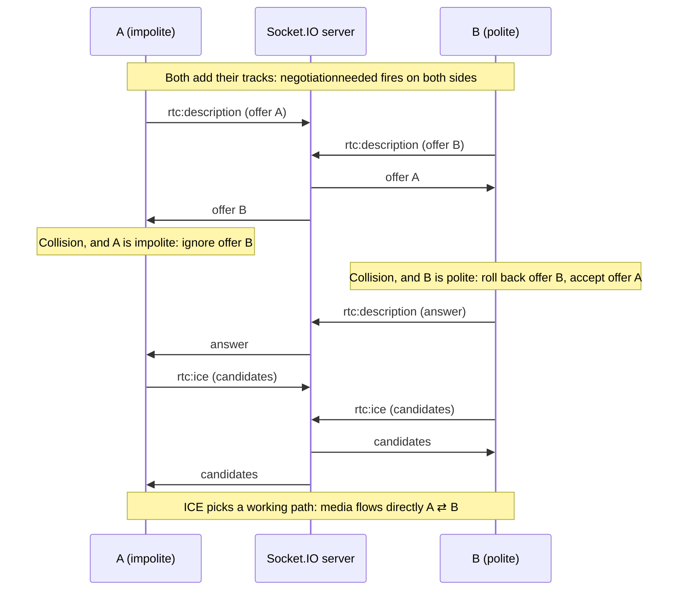

# Voice and video calls (WebRTC)

Every room has one call, for up to 4 people. Media goes directly between browsers; the server only helps them find each other. The decision and its trade-offs are in [ADR-003](adr/003-webrtc-mesh.md).

| Where                                    | What                                                                  |
| ---------------------------------------- | --------------------------------------------------------------------- |
| `client/src/features/call/peer-link.ts`  | One `RTCPeerConnection` to one other person, with perfect negotiation |
| `client/src/features/call/useCall.ts`    | The call: device preview, joining, the mesh, mute and camera toggles  |
| `client/src/features/call/ice.ts`        | Fetches STUN and TURN servers from the API before joining             |
| `server/src/services/ice.ts`             | Signs time-limited TURN credentials                                   |
| `client/src/features/call/media.ts`      | `getUserMedia`, device lists, error messages, STUN servers            |
| `client/src/features/call/CallPanel.tsx` | The call bar, the preview and the video grid                          |
| `server/src/sockets/index.ts`            | `call:*` and `rtc:*` events: who's in the call, and relaying signals  |

## Joining a call

1. **Preview.** "Start a call" or "Join call" opens the camera and microphone (`getUserMedia`) and shows a mirrored preview, with pickers for each device (`enumerateDevices`). Device names only appear once permission is granted, so the list is read again after that, and whenever a device is plugged in or out (`devicechange`).
2. **Join.** `call:join` tells the server, which answers with this connection's id (`peerId`, the socket id) and the people already there. The count and the join run with no `await` between them, so two people can't both take the last place.
3. **Mesh.** The newcomer opens a link to each person in the ack; everyone else opens one to the newcomer when the `call:roster` update arrives. If a signal from someone arrives before the roster that announces them, the link is created on the spot.

Anyone in the room can join, viewers included: talking, like chat, doesn't change the code. If the camera and microphone are blocked or missing, the person can still join to listen and watch: the link asks to _receive_ audio and video (`recvonly` transceivers) without sending anything.

## Perfect negotiation

Both sides of a link run the same code. Either may need to send an offer at any time (when it joins, or after an ICE restart), so two offers can cross ("glare"). Each pair agrees, without talking, which side is **polite**: the one with the larger peer id.



The core of it, from `peer-link.ts`:

```ts
const collision = description.type === 'offer' && (makingOffer || pc.signalingState !== 'stable');
ignoreOffer = !polite && collision;
if (ignoreOffer) return;
await pc.setRemoteDescription(description); // the polite side rolls back here, implicitly
if (description.type === 'offer') {
  await pc.setLocalDescription(); // creates the answer
  send({ description: pc.localDescription });
}
```

Candidates that arrive before their description are held and applied once it's set. A link whose connection fails restarts ICE (`pc.restartIce()`), which gathers new candidates and renegotiates without ending the call. The tests in `peer-link.test.ts` run two links against a simulated connection, including both sides offering at once.

## Signalling events

| Direction | Event             | Payload                                         | Notes                                                      |
| --------- | ----------------- | ----------------------------------------------- | ---------------------------------------------------------- |
| C→S (ack) | `call:join`       | `{ slug, media }` → `{ peerId, peers }`         | Room joined first; at most 4; "The call is full" otherwise |
| C→S       | `call:leave`      | `{ slug }`                                      | Also on leaving the room and on disconnect                 |
| C→S       | `call:media`      | `{ slug, media: { audio, video } }`             | Mute and camera state, for the others' tiles               |
| S→C       | `call:roster`     | `{ slug, peers: [{ peerId, user, media }] }`    | To the whole room on every change, and after `room:join`   |
| C↔S       | `rtc:description` | `{ to, description }` / `{ from, description }` | Offers and answers; SDP at most 32 KB                      |
| C↔S       | `rtc:ice`         | `{ to, candidate }` / `{ from, candidate }`     | One network path                                           |

The server relays `rtc:*` messages only between two sockets in the **same call**, so knowing a socket id isn't enough to send someone offers. Each socket may send 200 signalling messages per 10 seconds. The server never sees media: WebRTC encrypts it end to end between the browsers (DTLS-SRTP).

If the socket drops, the server forgets the call. After reconnecting, the room channel rejoins the room, and a call in progress rejoins too: the socket id is new, so every link is rebuilt with the same mute and camera state. Restarting the API during a call reconnects it within a few seconds.

## Mute and camera

Mute and camera-off set `track.enabled = false`. The track keeps sending, but silence or black frames, so nothing has to be renegotiated and turning it back on is instant. `call:media` tells the others, whose tiles then show the person's initial and "muted" or "camera off". The `<video>` element stays mounted with the camera off, because the person's audio plays through it.

## STUN and TURN

Most devices sit behind a router (NAT) and only know their private address.

- **STUN** answers "what's my public address?". Peers exchange those addresses as ICE candidates and usually connect directly. A STUN server carries no media and is cheap to run. The client uses `VITE_STUN_URLS` (comma-separated), or a public Google STUN server by default.
- **TURN** relays the media itself when no direct path works: symmetric NATs, and networks that block UDP, such as some campus and office Wi-Fi. It costs bandwidth and could be abused, so it needs credentials.

Just before joining, the browser calls `GET /api/v1/turn-credentials`, which returns the STUN servers and, if configured, the TURN relay with credentials. It reuses them until five minutes before they expire, and falls back to STUN alone if the request fails.

The credentials follow coturn's `use-auth-secret` scheme (the "TURN REST API"). The API and coturn share `TURN_SECRET`:

```
username   = "<expiry, Unix seconds>:<user id>"      e.g. 1794765600:6730c2f4e1b2a3c4d5e6f701
credential = base64(HMAC-SHA1(TURN_SECRET, username))
```

coturn recomputes the HMAC to check a login and refuses it once the expiry time has passed (4 hours by default, `TURN_TTL_SECONDS`). Nothing is stored, and a leaked credential stops working by itself. A test checks the result against `openssl dgst -sha1 -hmac`.

In production, coturn runs as the `turn` service in `docker-compose.prod.yml`: UDP and TCP on 3478, relays on UDP 49160–49200, refusing to relay to private addresses. See [deployment.md](deployment.md). Without `TURN_URLS` and `TURN_SECRET` (as in development), only STUN is handed out and the API logs a warning at start-up.

Not covered: networks that only allow HTTPS on port 443. That needs TURN over TLS on 443, which Caddy already uses.

## Why a mesh, and why 4

In a mesh, each person sends their stream to every other person: with _n_ people, each uploads _n − 1_ streams and downloads _n − 1_.

| People | Streams up per person | Upload at ~1 Mbps per video | Connections in the room |
| ------ | --------------------- | --------------------------- | ----------------------- |
| 2      | 1                     | ~1 Mbps                     | 1                       |
| 3      | 2                     | ~2 Mbps                     | 3                       |
| 4      | 3                     | ~3 Mbps                     | 6                       |
| 6      | 5                     | ~5 Mbps                     | 15                      |

Home upload speeds are often 5–10 Mbps, and the code editor and Socket.IO share it, so 4 is a safe limit. The preview asks for 640×360 video to keep each stream near 1 Mbps. Past that, an SFU (a media server such as LiveKit) is the usual answer: each person uploads one stream and the server forwards it, at the cost of running that server.
